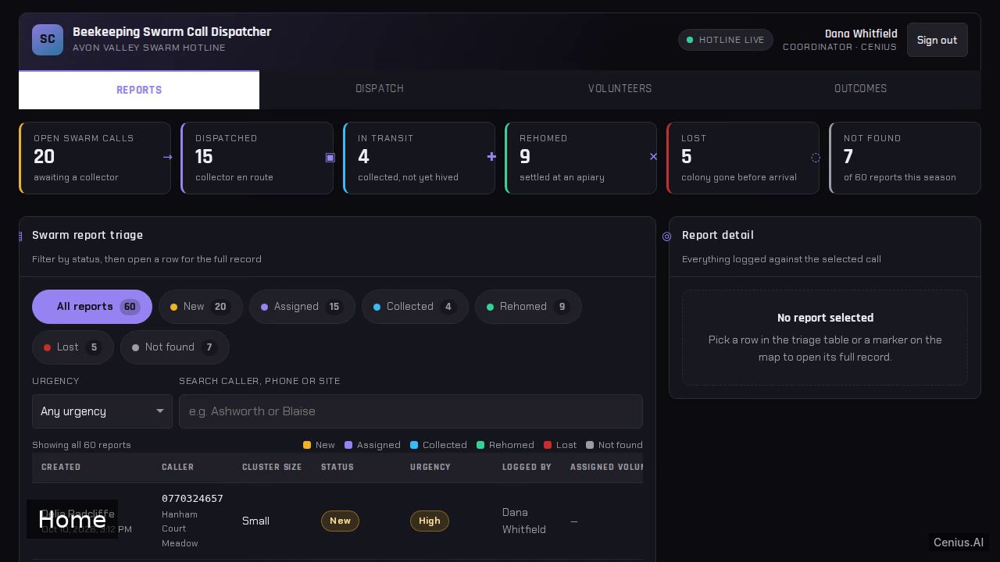
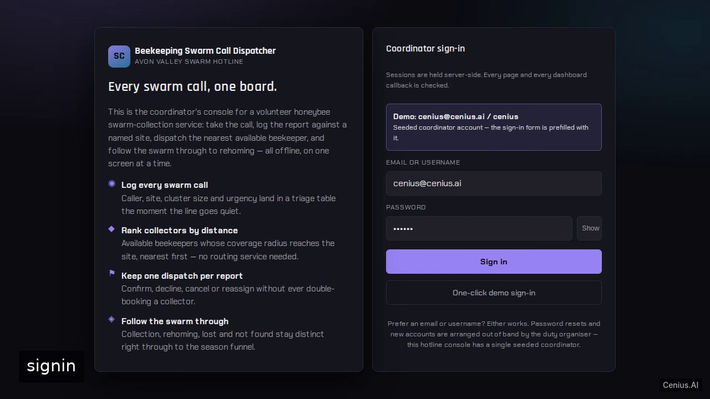

# Beekeeping Swarm Call Dispatcher — complete Full-stack app volunteer monitoring dashboard example app

This repository contains the complete source for **Beekeeping Swarm Call Dispatcher**, an open-source volunteer monitoring dashboard built with Full-stack app. A single-process Plotly Dash web app for a local beekeeping association that takes swarm calls from the public and gets a volunteer collector to the bees. Everything Beekeeping Swarm Call Dispatcher needs to run is here — code, seed data, install scripts. Apache-2.0-licensed — use Beekeeping Swarm Call Dispatcher commercially, self-host it, or [remix Beekeeping Swarm Call Dispatcher on cenius.ai](https://cenius.ai/marketplace/p/beekeeping-swarm-call-dispatcher?ref=gh&utm_campaign=beekeeping-swarm-call-dispatcher-webapp) to make it yours.


[](LICENSE)  [](https://cenius.ai)

[](https://cenius.ai/marketplace/p/beekeeping-swarm-call-dispatcher?ref=gh&utm_campaign=beekeeping-swarm-call-dispatcher-webapp)

> **▶ [Open & edit in cenius.ai](https://cenius.ai/marketplace/p/beekeeping-swarm-call-dispatcher?ref=gh&utm_campaign=beekeeping-swarm-call-dispatcher-webapp)** — one click to an editable workspace: describe changes in plain English, get an instant preview, one-click deploy and host. Modifications made on the platform come with full rebrand & relicense rights.

_Local clone? See [Quick start](#quick-start) below. cenius.ai is the zero-setup path._

## Demo


▶ **[See it in action](https://cenius.ai/marketplace/p/beekeeping-swarm-call-dispatcher?ref=gh&utm_campaign=beekeeping-swarm-call-dispatcher-webapp)** — full demo on the project page · [MP4](.github/media/demo.mp4)

## Screenshots

  

## Features

- Demo coordinator sign-in
- Log a swarm report by caller location and cluster size
- Swarm report map with markers and sortable table
- Volunteer collector roster with availability
- Distance-and-availability ranking of collectors
- Coordinator-confirmed dispatch
- Collected-swarm outcomes through to rehoming
- Dispatch lifecycle: decline, cancel, reassign

## Architecture

Open the repo and you'll find a complete Full-stack app application (65 files). Top-level layout: `data/`, `services/`, `static/`, `tests/`, `ui/`. `./install.sh` gets you from a fresh clone to a running instance with sample data in a single step. Step-by-step setup guide: [`INSTALL.md`](INSTALL.md).

## Quick start

```bash
./install.sh   # installs dependencies + seeds demo data
```

See [`INSTALL.md`](INSTALL.md) for full setup and usage instructions.

## Usage guide

A walkthrough of every surface, in the order a coordinator meets them.

### Signing in

Open <http://localhost:8050>. You land on `/signin`, which explains the product
and prefills the seeded coordinator credentials (the hint on the card reads
`Demo: cenius@cenius.ai / cenius`). Use **Show** to reveal the password, press
**Enter** or **Sign in** to submit, or take the **One-click demo sign-in** button.

Wrong credentials produce exactly one message — "Those credentials did not match.
Check the demo hint below." — whether the account exists or not. Ten failed
attempts from one address within fifteen minutes return `429` and a wait
message. **Sign out** in the app header clears the session server-side.

### Reports tab

The default tab. From top to bottom:

_Full guide: [`USAGE.md`](USAGE.md)_

## FAQ

### What does it take to self-host Beekeeping Swarm Call Dispatcher?

`git clone` + `./install.sh` gets you a running instance — the install script provisions dependencies and demo data. Full steps live in [`INSTALL.md`](INSTALL.md); nothing external is needed to try it.

### What technologies are in Beekeeping Swarm Call Dispatcher's stack?

Beekeeping Swarm Call Dispatcher runs on Full-stack app. This repo holds the full production source: you can inspect every part of it before deploying. Highlights include demo coordinator sign-in.

### Can I use Beekeeping Swarm Call Dispatcher in a commercial project?

Yes — Apache-2.0-licensed, so commercial use, modification, and distribution are all permitted. Read the full terms in [LICENSE](LICENSE).

### Is white-labeling Beekeeping Swarm Call Dispatcher allowed?

Yes — and the easiest way is [remixing it on cenius.ai](https://cenius.ai/marketplace/p/beekeeping-swarm-call-dispatcher?ref=gh&utm_campaign=beekeeping-swarm-call-dispatcher-webapp): modifications made on the platform come with full rebrand and relicense rights over your derivative.

### Can non-developers customise Beekeeping Swarm Call Dispatcher?

The easiest route: [visit the project on cenius.ai](https://cenius.ai/marketplace/p/beekeeping-swarm-call-dispatcher?ref=gh&utm_campaign=beekeeping-swarm-call-dispatcher-webapp), tell the platform what to change, and collect the updated build. No source-editing needed.

## License & rebranding

Released under the [Apache License 2.0](LICENSE) (© 2026 Cenius AI) — free for personal and commercial use. The Cenius name/logo are trademarks (see NOTICE).

**Need a customized version?** [Remix this app on cenius.ai](https://cenius.ai/marketplace/p/beekeeping-swarm-call-dispatcher?ref=gh&utm_campaign=beekeeping-swarm-call-dispatcher-webapp) — modifications made on the platform come with **full rebrand & relicense rights** over your derivative.

## Built with cenius.ai

This entire application — code, design, seeded demo data — was generated on **[cenius.ai](https://cenius.ai)** from a plain-English description.

- 🚀 [Build your own app on cenius.ai](https://cenius.ai)
- 🎛️ [Remix Beekeeping Swarm Call Dispatcher on the marketplace](https://cenius.ai/marketplace/p/beekeeping-swarm-call-dispatcher?ref=gh&utm_campaign=beekeeping-swarm-call-dispatcher-webapp) — open it in a workspace, prompt for changes, and ship your own version.

More open-source apps: [the Cenius-ai catalog](https://github.com/Cenius-ai) · [showcase index](https://github.com/Cenius-ai/showcase)
